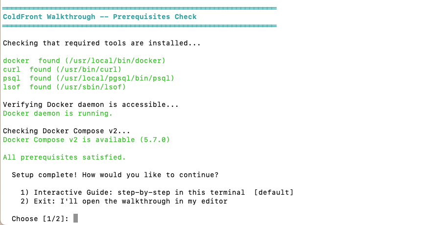
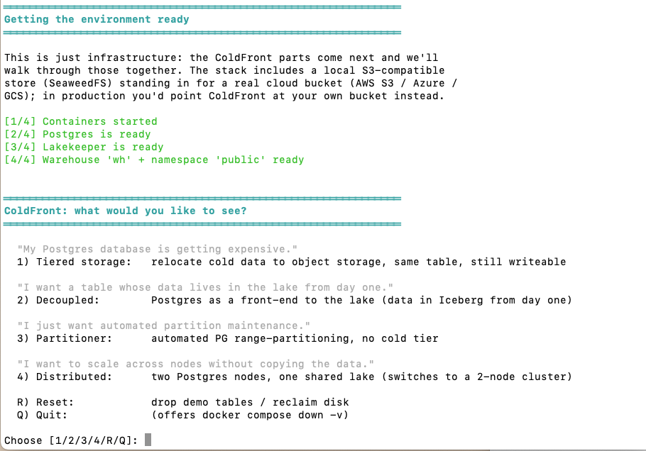
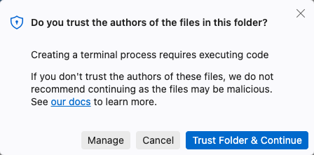
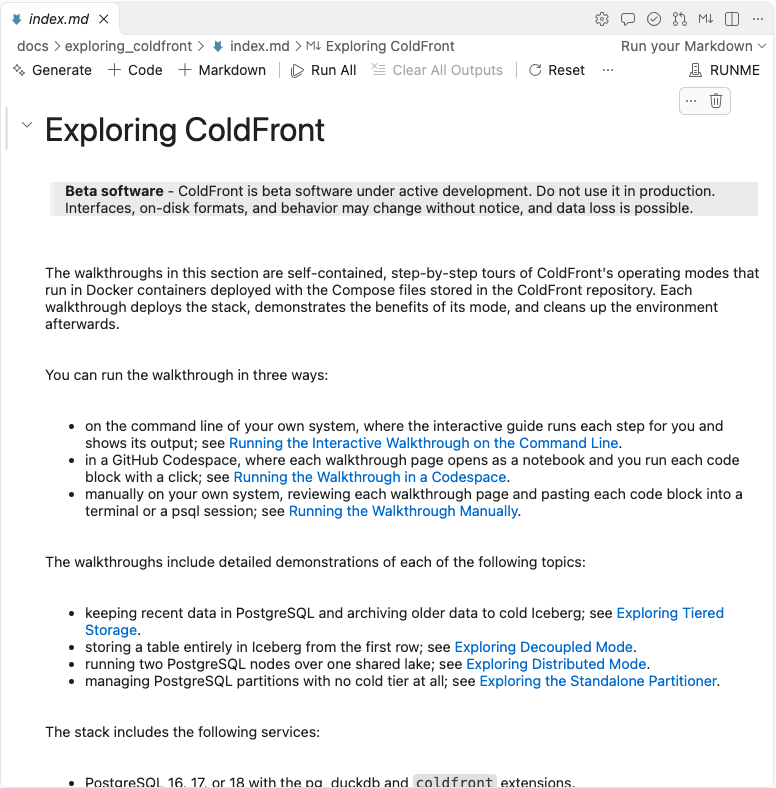

# Exploring ColdFront

> **Beta software** - ColdFront is beta software under active development. Do
> not use it in production. Interfaces, on-disk formats, and behavior may
> change without notice, and data loss is possible.

The walkthroughs in this section are self-contained, step-by-step tours of
ColdFront's operating modes that run in Docker containers deployed with the
Compose files stored in the ColdFront repository. Each walkthrough deploys the
stack, demonstrates the benefits of its mode, and cleans up the environment
afterwards.

You can run the walkthrough in three ways:

- on the command line of your own system, where the interactive guide runs
  each step for you and shows its output; see
  [Running the Interactive Walkthrough on the Command Line](#running-the-interactive-walkthrough-on-the-command-line).
- in a GitHub Codespace, where each demo page opens as a notebook and you run
  each code block with a click; see
  [Running the Walkthrough in a Codespace](#running-the-walkthrough-in-a-codespace).
- manually on your own system, reviewing each demo page and pasting each code
  block into a terminal or a psql session; see
  [Running the Walkthrough Manually](#running-the-walkthrough-manually).

The walkthroughs include detailed demonstrations of each of the following
topics:

- keeping recent data in PostgreSQL and archiving older data to cold Iceberg;
  see [Exploring Tiered Storage](../walkthrough_tiered.md).
- storing a table entirely in Iceberg from the first row; see
  [Exploring Decoupled Mode](../walkthrough_decoupled.md).
- running two PostgreSQL nodes over one shared lake; see
  [Exploring Distributed Mode](../walkthrough_distributed.md).
- managing PostgreSQL partitions with no cold tier at all; see
  [Exploring the Standalone Partitioner](../walkthrough_partitioner.md).

The stack includes the following services:

- PostgreSQL 16, 17, or 18 with the pg_duckdb and `coldfront` extensions.
- SeaweedFS, a local S3-compatible object store standing in for a real cloud
  bucket.
- Lakekeeper, the Iceberg REST catalog that tracks table metadata and file
  locations.
- Lakekeeper's own PostgreSQL database (`lakekeeper-db`), plus a one-shot
  `lakekeeper-migrate` job that applies its schema migrations and exits.

<div class="admonition hint">
<p class="admonition-title">Hint</p>
<p>The stack runs PostgreSQL 18 by default. To run 16 or 17, set
<code>PG_MAJOR</code> and change the <code>pgdata</code> volume path in
<code>docker-compose.yml</code> to match. For the distributed walkthrough, also
change the <code>pgdata1</code> and <code>pgdata2</code> volume paths in
<code>docker-compose.mesh.yml</code>.</p>
</div>

Before you run the walkthrough on the command line or manually, confirm that
your system meets the following prerequisites:

- Docker 24+ with Compose V2 (the `docker compose` plugin, not the legacy
  `docker-compose` binary).
- roughly 3 GB of free disk inside Docker's virtual disk (the images alone
  are about 2.5 GB).
- `curl`, `bash`, and `psql` reside on the host.
- `ss` on Linux or `lsof` on macOS, which the interactive guide uses to find
  free ports.

## Running the Interactive Walkthrough on the Command Line

On the command line, the interactive guide walks you through the deployment of
each ColdFront mode on your own system. For each mode, the guide shows the
commands that deploy and configure the stack, runs each command when you press
Enter, and demonstrates the benefits of using the selected mode with live
output.

Clone the [ColdFront repository](https://github.com/pgEdge/ColdFront), or use
the following curl command to download and deploy the walkthrough installer
(`examples/walkthrough/install.sh`):

```bash {"ignore":"true"}
curl -fsSL \
  https://raw.githubusercontent.com/pgEdge/ColdFront/main/examples/walkthrough/install.sh \
  | bash
```

The installer downloads the walkthrough files from the `main` branch into a
`coldfront-walkthrough` directory in the current directory.

<div class="admonition hint">
<p class="admonition-title">Hint</p>
<p>If you clone the repository, or exit the guide and want to start it again,
run the following command from the repository root or the
<code>coldfront-walkthrough</code> directory:</p>
<pre><code>bash examples/walkthrough/guide.sh</code></pre>
<p>If the two-node cluster from the distributed walkthrough is still running,
the guide removes the cluster and its data volumes when it starts, without
asking first.</p>
</div>

The installer then checks that the prerequisites are installed and asks how to
continue; choose `1) Interactive Guide` to start the guide:



The guide builds the Docker images on first run, brings up the stack, and
presents the four demos as a menu - tiered, decoupled, partitioner, and
distributed - plus options to reset the demo tables or tear the stack down:



The guide prints each demo command and query before execution. To have the
guide type each one a character at a time, as in a recording, set
`WALKTHROUGH_TYPE_DELAY` to the delay in seconds between characters (for
example, `0.03`). The default of `0` prints each command at once.

The `R) Reset` option drops the tables every demo created, in PostgreSQL and in
the Iceberg catalog, and keeps the stack running. If the two-node cluster from
the distributed demo is up, Reset first removes the cluster and its data
volumes, including any data that you added, and then brings back the
single-node stack.

<div class="admonition hint">
<p class="admonition-title">Hint</p>
<p>Review the
<a href="https://github.com/pgEdge/ColdFront/blob/main/examples/walkthrough/README.md">walkthrough README</a>
to see a list of the installer's options, such as deploying in another
directory or from another branch.</p>
</div>

## Running the Walkthrough in a Codespace

A Codespace deploys the walkthrough in your browser, using resources hosted at
GitHub.

To start the walkthrough in a Codespace,
<a href="https://github.com/codespaces/new?repo=pgEdge/coldfront" target="_blank" rel="noopener">open the ColdFront repository in a Codespace</a>
(the link opens in a new tab), and select `Create codespace`. Setting up the
Codespace takes a few minutes. When VS Code asks whether you trust the authors
of the files in the folder, select `Trust Folder & Continue`:



Docker, psql, and the
[Runme extension](https://marketplace.visualstudio.com/items?itemName=stateful.runme)
are preinstalled in the Codespace.

When the Codespace is ready, it opens the documentation as a notebook, at the
Exploring ColdFront page:



Select a demo to continue; for example, the Exploring Tiered Storage link opens
the tiered demo:


At the top of each walkthrough, a list of steps describes the actions that the
walkthrough performs.

To start the walkthrough, scroll down to the first code block, move your cursor
into the code block, and click the triangle that appears to its left. While the
code block runs, the triangle becomes a stop button. When the code block
finishes, a check mark and the run time appear under the commands, and the
output appears below the code block:


The distributed demo is the exception. Its page shows how to run the demo with
the interactive guide from a terminal in the Codespace.

## Running the Walkthrough Manually

To run the walkthrough manually, review each demo page, pasting each code block
into a terminal or a psql session. Your system needs the prerequisites listed
at the start of this page.

To get the walkthrough files, clone the
[ColdFront repository](https://github.com/pgEdge/ColdFront), or use the
following curl command to download and deploy the walkthrough installer:

```bash {"ignore":"true"}
curl -fsSL \
  https://raw.githubusercontent.com/pgEdge/ColdFront/main/examples/walkthrough/install.sh \
  | bash
```

When the installer asks how to continue, choose `2) Exit` to continue manually.

Work from the repository root, or from the `coldfront-walkthrough` directory if
you used the installer. Each walkthrough page includes a
`Running the Walkthrough Manually` section that starts the stack; complete
that section before performing each step on the page in order.

## Changing the Demo Ports

If port 5432, 8181, or 8333 is already in use on your host, set
`COLDFRONT_PG_PORT`, `COLDFRONT_LK_PORT`, or `COLDFRONT_S3_PORT` before the
`docker compose up` command on a demo page. If you remap the PG port, match it
in the `psql` commands of the demos. If you remap the Lakekeeper port, match it
in the `curl` commands of the demos.

## Using a Cloud Object Store

The walkthrough uses SeaweedFS by default. To use a cloud store instead,
replace the warehouse JSON in the bootstrap commands on the demo pages, the
`set_storage_secret` call in
[Step 5](../walkthrough_tiered.md#pointing-coldfront-at-the-object-store)
(Pointing ColdFront at the Object Store) of the tiered demo, and the `s3:`
block in `examples/walkthrough/config/archiver.yaml`, which `import` writes
into the server as the storage secret.

The following table shows the `set_storage_secret` signature for each supported
store:

| Store | set_storage_secret call |
|-------|------------------------|
| SeaweedFS (local) | `SELECT coldfront.set_storage_secret('admin', 'adminsecret', 'seaweedfs:8333');` |
| AWS S3 | `SELECT coldfront.set_storage_secret('key-id', 'secret-key', null, 'ap-south-2');` |
| GCS (HMAC) | `SELECT coldfront.set_storage_secret(p_key_id => '<hmac-key>', p_secret => '<hmac-secret>', p_endpoint => 'storage.googleapis.com', p_region => 'us-east-1', p_url_style => 'path', p_use_ssl => true);` |
| Azure ADLS Gen2 | `SELECT coldfront.set_storage_secret_azure('AccountName=<account>;AccountKey=<key>;EndpointSuffix=core.windows.net');` |

The [Configuring your Object Store](../object_store.md) guide shows the
matching Lakekeeper warehouse JSON for each of these backends.
