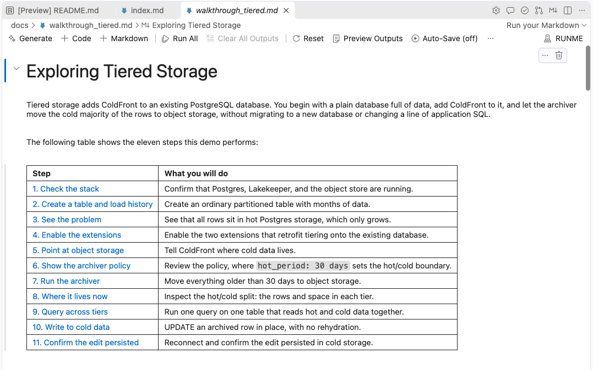
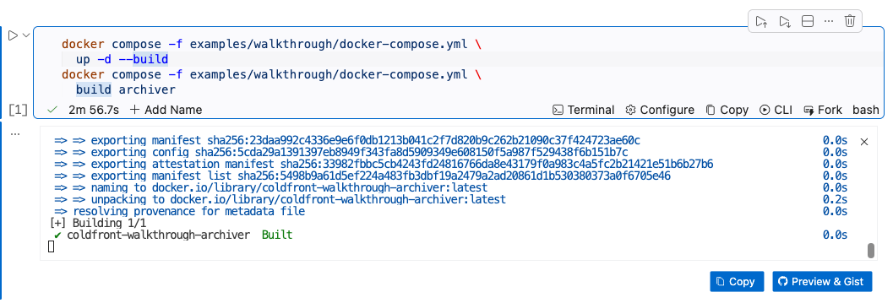

# Exploring ColdFront

Each of the following walkthroughs contains the steps to deploy the stack,
demonstrate the benefits of each deployment architecture, and clean up the
environment afterwards:

- [Exploring Tiered Storage](../walkthrough_tiered.md) demonstrates keeping
  recent data in PostgreSQL and archiving older data to cold Iceberg.
- [Exploring Decoupled Mode](../walkthrough_decoupled.md) demonstrates storing
  a table entirely in Iceberg from the first row.
- [Exploring Distributed Mode](../walkthrough_distributed.md) demonstrates
  running two PostgreSQL nodes over one shared lake.
- [Exploring the Standalone Partitioner](../walkthrough_partitioner.md)
  demonstrates managing PostgreSQL partitions with no cold tier at all.

You can use the Exploring pages to take a self-contained, step-by-step tour of
ColdFront's three operating modes in a GitHub Codespace, or deploy the
walkthrough on your own system. Either way, the walkthrough runs in Docker
containers deployed with the Compose files in the ColdFront repository.

> **Beta software** - ColdFront is beta software under active development. Do
> not use it in production. Interfaces, on-disk formats, and behavior may
> change without notice, and data loss is possible.

## Choosing How to Run the Walkthrough

You can run the walkthrough in three ways:

- in a GitHub Codespace, where each demo page opens as a notebook and you run
  each code block with a click; see
  [Running the Walkthrough in a Codespace](#running-the-walkthrough-in-a-codespace).
- on the command line of your own system, where the interactive guide runs
  each step for you and shows its output; see
  [Running the Walkthrough on the Command Line](#running-the-walkthrough-on-the-command-line).
- manually on your own system, following each demo page and pasting its
  commands into a terminal and a psql session; see
  [Running the Walkthrough Manually](#running-the-walkthrough-manually).

## Understanding the Demo Stack

The walkthrough runs ColdFront and the services it depends on in Docker
containers. The stack includes the following services:

- PostgreSQL 16, 17, or 18 with the pg_duckdb and `coldfront` extensions.
- SeaweedFS, a local S3-compatible object store standing in for a real cloud
  bucket.
- Lakekeeper, the Iceberg REST catalog that tracks table metadata and file
  locations.
- Lakekeeper's own PostgreSQL database (`lakekeeper-db`), plus a one-shot
  `lakekeeper-migrate` job that applies its schema migrations and exits.

The stack runs PostgreSQL 18 by default. To run 16 or 17, set `PG_MAJOR` before
`up` and change the `pgdata` volume path in `docker-compose.yml` to match.

## Running the Walkthrough in a Codespace

A Codespace runs the walkthrough in your browser, with nothing to install on
your own system.
<a href="https://github.com/codespaces/new?repo=pgEdge/coldfront" target="_blank" rel="noopener">Open this repo in a Codespace</a>
(the link opens in a new tab), select `Create codespace`, and select
`Trust Folder & Continue` when VS Code asks whether you trust the authors of
the files in the folder. Docker, psql, and the
[Runme extension](https://marketplace.visualstudio.com/items?itemName=stateful.runme)
are preinstalled.

Setting up the Codespace takes a few minutes. When the Codespace is ready, it
opens this page as a notebook, with the list of demos at the top:


Click a demo in the list to open that demo as a notebook. For example, the
Exploring Tiered Storage link opens the tiered demo:



To run a cell, point to the cell and click the triangle that appears to its
left. While the cell runs, the triangle becomes a stop button. When the cell
finishes, a check mark and the run time appear under the commands, and the
output appears below the cell:



The distributed demo is the exception. Its page shows how to run the demo with
the interactive guide from a terminal in the Codespace.

## Running the Walkthrough on the Command Line

On the command line, the interactive guide runs each walkthrough for you on
your own system and shows the output of each step. Before you start, confirm
that your system meets the following prerequisites:

- Docker 24+ with Compose V2 (the `docker compose` plugin, not the legacy
  `docker-compose` binary).
- roughly 3 GB of free disk inside Docker's virtual disk (the images alone
  are about 2.5 GB).
- `curl`, `bash`, and `psql` reside on the host.
- `ss` on Linux or `lsof` on macOS, which the interactive guide uses to find
  free ports.

### Downloading the Walkthrough Files

Clone the [ColdFront repository](https://github.com/pgEdge/ColdFront), or use
the walkthrough installer (`examples/walkthrough/install.sh`) to download only
the walkthrough files. Use the following command to download the installer
from GitHub and run it:

```bash {"ignore":"true"}
curl -fsSL \
  https://raw.githubusercontent.com/pgEdge/ColdFront/main/examples/walkthrough/install.sh \
  | bash
```

The installer downloads the walkthrough files from the `main` branch into a
`coldfront-walkthrough` directory in the current directory, and checks that
Docker, Docker Compose, `curl`, and `psql` are installed. The installer then
asks how to continue; choose `1) Interactive Guide` to start the guide. The
[walkthrough README](https://github.com/pgEdge/ColdFront/blob/main/examples/walkthrough/README.md)
describes the installer's options, such as choosing another directory or
branch.

### Using the Interactive Guide

If you cloned the repository, or quit the guide and want to start it again,
run the following command from the repository root or the
`coldfront-walkthrough` directory:

```bash {"ignore":"true"}
bash examples/walkthrough/guide.sh
```

The guide builds the Docker images on first run, brings up the stack, and
presents the four demos as a menu - tiered, decoupled, partitioner, and
distributed - plus options to reset the demo tables or tear the stack down. In
the guide's menu, the R) Reset option drops the tables every demo created, in
PostgreSQL and in the Iceberg catalog, and keeps the stack running. If the
two-node cluster from the distributed demo is up, Reset first removes the
cluster and its data volumes, including any data that you added, and then
brings back the single-node stack.

The guide prints each demo command and query before it runs it. To have the
guide type each one a character at a time, as in a recording, set
`WALKTHROUGH_TYPE_DELAY` to the delay in seconds between characters (for
example, `0.03`). The default of `0` prints each command at once.

## Running the Walkthrough Manually

To run the walkthrough by hand, follow each demo page and paste its commands
into a terminal and a psql session. Your system needs the prerequisites listed
in
[Running the Walkthrough on the Command Line](#running-the-walkthrough-on-the-command-line).

To get the walkthrough files, clone the
[ColdFront repository](https://github.com/pgEdge/ColdFront), or run the
installer command in
[Downloading the Walkthrough Files](#downloading-the-walkthrough-files) and
choose `2) Exit` when the installer asks how to continue.

Work from the repository root, or from the `coldfront-walkthrough` directory if
you used the installer. Open a demo page and follow its Running This Demo on
Your Own System section, which starts the stack, and then run each step in
order.

### Changing the Demo Ports

If port 5432, 8181, or 8333 is already in use on your host, set
`COLDFRONT_PG_PORT`, `COLDFRONT_LK_PORT`, or `COLDFRONT_S3_PORT` before the
`docker compose up` command on a demo page. If you remap the PG port, match it
in the `psql` commands of the demos. If you remap the Lakekeeper port, match it
in the `curl` commands of the demos.

## Running the Demos

Open any demo page and follow the section for your environment. Each page
starts the stack, runs the demo, and ends with a When You Finish section, so
you can run the demos in any order.

## Using a Cloud Object Store

The walkthrough uses SeaweedFS by default. To use a cloud store instead,
replace the warehouse JSON in the bootstrap commands on the demo pages, the
`set_storage_secret` call in
[Step 5](../walkthrough_tiered.md#pointing-coldfront-at-the-object-store)
(Pointing ColdFront at the Object Store) of the tiered demo, and the `s3:`
block in `examples/walkthrough/config/archiver.yaml`, which `import` writes
into the server as the storage secret.

The following table shows the `set_storage_secret` signature for each supported
store:

| Store | set_storage_secret call |
|-------|------------------------|
| SeaweedFS (local) | `SELECT coldfront.set_storage_secret('admin', 'adminsecret', 'seaweedfs:8333');` |
| AWS S3 | `SELECT coldfront.set_storage_secret('key-id', 'secret-key', null, 'ap-south-2');` |
| GCS (HMAC) | `SELECT coldfront.set_storage_secret(p_key_id => '<hmac-key>', p_secret => '<hmac-secret>', p_endpoint => 'storage.googleapis.com', p_region => 'us-east-1', p_url_style => 'path', p_use_ssl => true);` |
| Azure ADLS Gen2 | `SELECT coldfront.set_storage_secret_azure('AccountName=<account>;AccountKey=<key>;EndpointSuffix=core.windows.net');` |

The [Configuring your Object Store](../object_store.md) guide shows the
matching Lakekeeper warehouse JSON for each of these backends.
