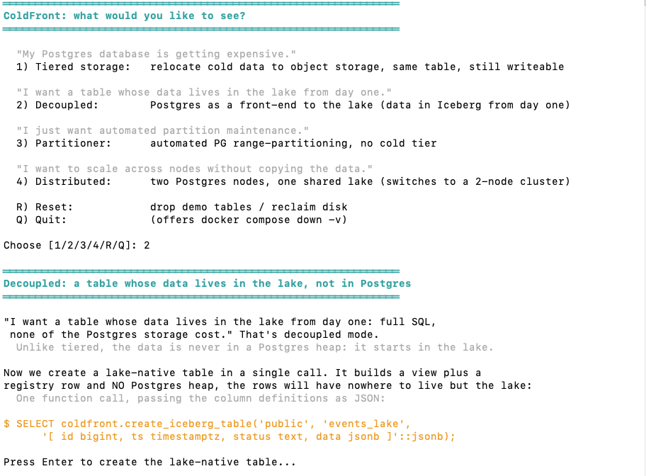
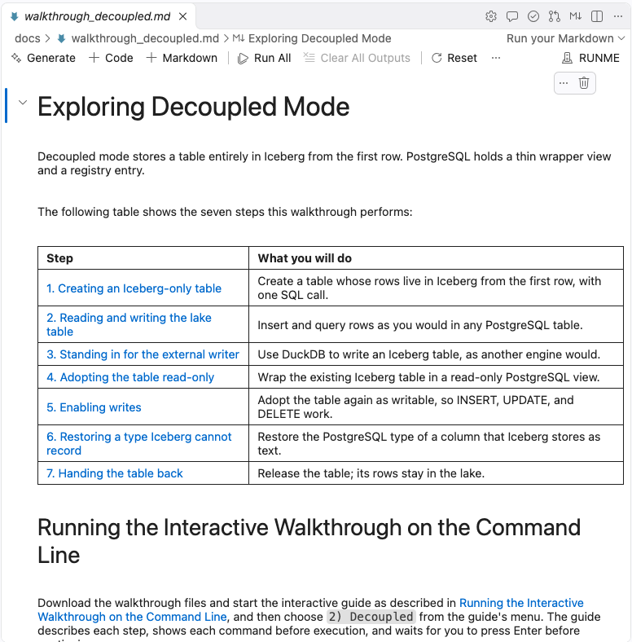

# Exploring Decoupled Mode

Decoupled mode stores a table entirely in Iceberg from the first row.
PostgreSQL holds a thin wrapper view and a registry entry.

The following table shows the eight steps this walkthrough performs:

| Step | What you will do |
|------|-----------------|
| [1. Preparing the database](#preparing-the-database) | Create the extensions and register the object store credential. |
| [2. Creating an Iceberg-only table](#creating-an-iceberg-only-table) | Create a table whose rows live in Iceberg from the first row, with one SQL call. |
| [3. Reading and writing the lake table](#reading-and-writing-the-lake-table) | Insert and query rows as you would in any PostgreSQL table. |
| [4. Standing in for the external writer](#standing-in-for-the-external-writer) | Use DuckDB to write an Iceberg table, as another engine would. |
| [5. Adopting the table read-only](#adopting-the-table-read-only) | Wrap the existing Iceberg table in a read-only PostgreSQL view. |
| [6. Enabling writes](#enabling-writes) | Adopt the table again as writable, so INSERT, UPDATE, and DELETE work. |
| [7. Restoring a type Iceberg cannot record](#restoring-a-type-iceberg-cannot-record) | Restore the PostgreSQL type of a column that Iceberg stores as text. |
| [8. Handing the table back](#handing-the-table-back) | Release the table; its rows stay in the lake. |

## Running the Interactive Walkthrough on the Command Line

Download the walkthrough files and start the interactive guide as described in
[Running the Interactive Walkthrough on the Command Line](exploring_coldfront/index.md#running-the-interactive-walkthrough-on-the-command-line),
and then choose `2) Decoupled` from the guide's menu. The guide describes
each step, shows each command before execution, and waits for you to press
Enter before continuing:



The sections that follow explain each step as the walkthrough executes.
When the walkthrough ends, the guide offers to drop the `events_lake` table
before returning to the menu.

## Running the Walkthrough in a Codespace

Create the Codespace as described in
[Running the Walkthrough in a Codespace](exploring_coldfront/index.md#running-the-walkthrough-in-a-codespace).
The Codespace opens the Exploring ColdFront page; click Exploring Decoupled
Mode to open this page as a notebook:



To run a code block, click the triangle to the left of the code block.

<div class="admonition hint">
<p class="admonition-title">Hint</p>
<p>The first time you start the stack, Docker builds the images, which can take
several minutes. If you start the stack again, Docker reuses the images and the
stack starts within a minute.</p>
</div>

Run the following code block to start the containers:

```bash
docker compose -f examples/walkthrough/docker-compose.yml \
  up -d --build
docker compose -f examples/walkthrough/docker-compose.yml \
  build archiver
```

Run the following code block to bootstrap Lakekeeper, create the `wh` warehouse
backed by SeaweedFS, and seed the `public` namespace. The code block makes one
attempt, so run it again if the warehouse request fails:

```bash
# Bootstrap Lakekeeper (one-time per fresh stack)
curl -sf -X POST http://localhost:8181/management/v1/bootstrap \
  -H 'Content-Type: application/json' \
  -d '{"accept-terms-of-use":true}'

# Create the warehouse and save its ID (retried by guide.sh until 200)
WID=$(curl -sf -X POST http://localhost:8181/management/v1/warehouse \
  -H 'Content-Type: application/json' \
  -d '{
    "warehouse-name": "wh",
    "storage-profile": {
      "type": "s3",
      "bucket": "iceberg",
      "region": "us-east-1",
      "endpoint": "http://seaweedfs:8333",
      "path-style-access": true,
      "flavor": "s3-compat",
      "sts-enabled": false,
      "remote-signing-enabled": false
    },
    "storage-credential": {
      "type": "s3",
      "credential-type": "access-key",
      "aws-access-key-id": "admin",
      "aws-secret-access-key": "adminsecret"
    }
  }' \
  | grep -oE '"warehouse-id":"[^"]+"' | cut -d'"' -f4)

# Seed the public namespace
if [ -z "$WID" ]; then
  echo "No warehouse ID - check that the warehouse create succeeded."
else
  curl -sf -X POST \
    "http://localhost:8181/catalog/v1/${WID}/namespaces" \
    -H 'Content-Type: application/json' \
    -d '{"namespace":["public"]}'
fi
```

Then click the triangle beside each code block that follows, in order, starting
with the first step, [Preparing the Database](#preparing-the-database).

## Running the Walkthrough Manually

If you are using a Codespace, run the code blocks in the previous section
instead of the commands in this section.

Prepare your system as described in
[Running the Walkthrough Manually](exploring_coldfront/index.md#running-the-walkthrough-manually),
and then work from the repository root, or from the `coldfront-walkthrough`
directory if you used the installer.

As you work through the walkthrough:

- paste each shell command into a terminal.
- paste each SQL block into a psql session that you open with the following
  command, which hides the informational notices that pg_duckdb prints:
  `psql "postgresql://coldfront@localhost:5432/coldfront?options=-cclient_min_messages%3Dwarning"`.

<div class="admonition hint">
<p class="admonition-title">Hint</p>
<p>The first time you start the stack, Docker builds the images, which can take
several minutes. If you start the stack again, Docker reuses the images and the
stack starts within a minute.</p>
</div>

Use the following commands to start the containers and then bootstrap
Lakekeeper:

```bash {"ignore":"true"}
docker compose -f examples/walkthrough/docker-compose.yml \
  up -d --build
docker compose -f examples/walkthrough/docker-compose.yml \
  build archiver
```

```bash {"ignore":"true"}
# Bootstrap Lakekeeper (one-time per fresh stack)
curl -sf -X POST http://localhost:8181/management/v1/bootstrap \
  -H 'Content-Type: application/json' \
  -d '{"accept-terms-of-use":true}'

# Create the warehouse and save its ID (retried by guide.sh until 200)
WID=$(curl -sf -X POST http://localhost:8181/management/v1/warehouse \
  -H 'Content-Type: application/json' \
  -d '{
    "warehouse-name": "wh",
    "storage-profile": {
      "type": "s3",
      "bucket": "iceberg",
      "region": "us-east-1",
      "endpoint": "http://seaweedfs:8333",
      "path-style-access": true,
      "flavor": "s3-compat",
      "sts-enabled": false,
      "remote-signing-enabled": false
    },
    "storage-credential": {
      "type": "s3",
      "credential-type": "access-key",
      "aws-access-key-id": "admin",
      "aws-secret-access-key": "adminsecret"
    }
  }' \
  | grep -oE '"warehouse-id":"[^"]+"' | cut -d'"' -f4)

# Seed the public namespace
if [ -z "$WID" ]; then
  echo "No warehouse ID - check that the warehouse create succeeded."
else
  curl -sf -X POST \
    "http://localhost:8181/catalog/v1/${WID}/namespaces" \
    -H 'Content-Type: application/json' \
    -d '{"namespace":["public"]}'
fi
```

If port 5432, 8181, or 8333 is already in use on your host, see
[Changing Port Assignments](exploring_coldfront/index.md#changing-port-assignments).

When the stack is running, continue with the first step,
[Preparing the Database](#preparing-the-database).

## Performing the Walkthrough Steps

The following sections explain what each step does and what its output shows.
If you are running the walkthrough manually, paste each code block into a
terminal or a psql session, in order. The interactive guide follows the same
sequence but may combine or skip some steps, so its output can differ from the
output on this page.

### Preparing the Database

This walkthrough requires the `pg_duckdb` and `coldfront` extensions and the
object store credential. If you ran the tiered walkthrough on this stack with
the local SeaweedFS store, both are already in place, and running these steps
again changes nothing. If you configured a cloud object store instead, skip
the `set_storage_secret` call, because the call replaces the stored credential
with the SeaweedFS credential.

Run the following SQL to create both extensions:

```sql {"interpreter":"psql postgresql://coldfront@localhost:5432/coldfront?options=-cclient_min_messages%3Dwarning -v ON_ERROR_STOP=1 -P pager=off -f"}
CREATE EXTENSION IF NOT EXISTS pg_duckdb;
CREATE EXTENSION IF NOT EXISTS coldfront;
```

Register the local SeaweedFS credentials:

```sql {"interpreter":"psql postgresql://coldfront@localhost:5432/coldfront?options=-cclient_min_messages%3Dwarning -v ON_ERROR_STOP=1 -P pager=off -f"}
SELECT coldfront.set_storage_secret(
  'admin', 'adminsecret', 'seaweedfs:8333'
);
```

The [tiered walkthrough](walkthrough_tiered.md#enabling-the-extensions) describes
what each extension does and how to use a real object store instead.

### Creating an Iceberg-Only Table

One SQL call provisions the Iceberg table and the PostgreSQL view. The `public`
namespace was seeded during setup, and the call wraps both steps in a single
transaction:

```sql {"interpreter":"psql postgresql://coldfront@localhost:5432/coldfront?options=-cclient_min_messages%3Dwarning -v ON_ERROR_STOP=1 -P pager=off -f"}
SELECT coldfront.create_iceberg_table(
  'public',
  'events_lake',
  '[
    {"name":"id",     "type":"bigint"},
    {"name":"ts",     "type":"timestamptz"},
    {"name":"status", "type":"text"},
    {"name":"data",   "type":"jsonb"}
  ]'::jsonb
);
```

After the call returns, `events_lake` is a view; every row lives in Iceberg on
S3.

### Reading and Writing the Lake Table

`events_lake` behaves like any PostgreSQL table:

```sql {"interpreter":"psql postgresql://coldfront@localhost:5432/coldfront?options=-cclient_min_messages%3Dwarning -v ON_ERROR_STOP=1 -P pager=off -f"}
INSERT INTO events_lake VALUES
  (1, now(), 'ok',  '{"a":1}'),
  (2, now(), 'ok',  '{"a":2}');

SELECT count(*) AS rows_in_lake FROM events_lake;

UPDATE events_lake SET status = 'upd' WHERE id = 1;

SELECT id, status FROM events_lake ORDER BY id;

DELETE FROM events_lake WHERE id = 2;

SELECT count(*) AS after_delete FROM events_lake;
```

All four DML operations reach the Iceberg table transparently. The `coldfront`
extension intercepts each statement on the view and rewrites it to the Iceberg
path via pg_duckdb.

### Standing In for the External Writer

ColdFront can also use an Iceberg table that another engine has already
written. Instead of creating the table, ColdFront adopts it. Adoption reads
the table's schema from the Iceberg catalog and adds the wrapper view and
registry entry that make the table available in PostgreSQL. This step and the
four that follow adopt such a table and then hand it back.

In a real deployment, another engine writes this table to the lake. The next
two code blocks stand in for that engine. They use DuckDB, through
`duckdb.raw_query()`, to create an Iceberg namespace and a table and to insert
two rows. These are the only DuckDB SQL statements in the walkthrough. Each
code block first calls `coldfront.ensure_attached()`, which attaches the
Iceberg catalog to DuckDB.

The first code block creates the `ice.lake` namespace on its own. DuckDB sends
an Iceberg `CREATE TABLE` to the catalog immediately, but defers
`CREATE SCHEMA` until the transaction commits, so the namespace must exist
before the next code block creates the table in it:

```sql {"interpreter":"psql postgresql://coldfront@localhost:5432/coldfront?options=-cclient_min_messages%3Dwarning -v ON_ERROR_STOP=1 -P pager=off -f"}
SELECT coldfront.ensure_attached();
SELECT duckdb.raw_query('CREATE SCHEMA IF NOT EXISTS ice.lake');
```

The second code block creates the `ice.lake.orders` table and inserts two
rows. The `meta` column is a `VARCHAR` that holds JSON, which matters when you
restore its type later in this walkthrough:

```sql {"interpreter":"psql postgresql://coldfront@localhost:5432/coldfront?options=-cclient_min_messages%3Dwarning -v ON_ERROR_STOP=1 -P pager=off -f"}
SELECT coldfront.ensure_attached();
SELECT duckdb.raw_query($$
  CREATE TABLE IF NOT EXISTS ice.lake.orders (
    order_id BIGINT, placed_at TIMESTAMP WITH TIME ZONE,
    customer VARCHAR, amount DECIMAL(12,2), meta VARCHAR)$$);
SELECT duckdb.raw_query($$
  INSERT INTO ice.lake.orders VALUES
    (1, now(), 'acme', 19.99, '{"tier":"gold"}'),
    (2, now(), 'globex', 249.50, '{"tier":"silver"}')$$);
```

### Adopting the Table Read-Only

Adoption takes one call and no column list. The view goes in the PostgreSQL
schema `public`; `lake` is the Iceberg namespace, and no PostgreSQL schema of
that name is needed:

```sql {"interpreter":"psql postgresql://coldfront@localhost:5432/coldfront?options=-cclient_min_messages%3Dwarning -v ON_ERROR_STOP=1 -P pager=off -f"}
SELECT coldfront.adopt_iceberg_table('public', 'orders', 'lake');

SELECT order_id, customer, amount FROM orders ORDER BY order_id;
```

The call reports what it registered in a `NOTICE`. The connection settings on
this page hide notices, so the message appears only in a session that shows
them, such as a plain `psql` session:

```text {"ignore":"true"}
NOTICE:  coldfront: adopted "ice"."lake"."orders" as public.orders (5 columns, read-only)
```

Writes are refused, and the message says what to do:

```sql {"interpreter":"psql postgresql://coldfront@localhost:5432/coldfront?options=-cclient_min_messages%3Dwarning -P pager=off -f"}
UPDATE orders SET amount = 0 WHERE order_id = 1;
```

The refusal reads:

```text {"ignore":"true"}
ERROR:  coldfront: "public.orders" is adopted read-only
HINT:  Release it with coldfront.release_iceberg_table() and adopt again with p_writable => true to arm INSERT/UPDATE/DELETE.
```

### Enabling Writes

Adoption binds the name once, so to enable writes, you release the table with
`coldfront.release_iceberg_table()` and adopt it again with
`coldfront.adopt_iceberg_table()` and `p_writable => true`. The second
adoption gives the view the same DML rewrite that a created table gets. Every
write below is one bakery-serialized Iceberg snapshot:

```sql {"interpreter":"psql postgresql://coldfront@localhost:5432/coldfront?options=-cclient_min_messages%3Dwarning -v ON_ERROR_STOP=1 -P pager=off -f"}
SELECT coldfront.release_iceberg_table('public', 'orders');
SELECT coldfront.adopt_iceberg_table('public', 'orders', 'lake',
                                     p_writable => true);

INSERT INTO orders VALUES (3, now(), 'initech', 42.00, '{"tier":"bronze"}');
UPDATE orders SET amount = 21.00 WHERE order_id = 3;
DELETE FROM orders WHERE order_id = 1;

SELECT order_id, customer, amount FROM orders ORDER BY order_id;
```

### Restoring a Type Iceberg Cannot Record

The `meta` column reads as text, because Iceberg stores JSON as `VARCHAR` and
records no PostgreSQL type. `p_types` restores the column's type, and the
override is accepted because it maps to what the catalog stores:

```sql {"interpreter":"psql postgresql://coldfront@localhost:5432/coldfront?options=-cclient_min_messages%3Dwarning -v ON_ERROR_STOP=1 -P pager=off -f"}
SELECT coldfront.release_iceberg_table('public', 'orders');
SELECT coldfront.adopt_iceberg_table('public', 'orders', 'lake',
                                     p_writable => true,
                                     p_types    => '{"meta":"jsonb"}'::jsonb);

SELECT order_id, meta->>'tier' AS tier FROM orders ORDER BY order_id;
```

### Handing the Table Back

The `coldfront.release_iceberg_table()` function removes the view and the
registry row and performs no Iceberg I/O, so the table keeps every row and
stays in the catalog:

```sql {"interpreter":"psql postgresql://coldfront@localhost:5432/coldfront?options=-cclient_min_messages%3Dwarning -v ON_ERROR_STOP=1 -P pager=off -f"}
SELECT coldfront.release_iceberg_table('public', 'orders');
```

Keep two points in mind when you adopt a table. Iceberg records no PostgreSQL
type, so a `VARCHAR` column comes back as `text`, not `jsonb`, unless you set
its type with `p_types`. The bakery also serializes only ColdFront's own
writers; it does not coordinate with another engine that writes the same
table.

## When You Finish

When you finish the walkthrough, use the following command to stop the stack
and remove its data. The tiered, decoupled, and partitioner walkthroughs share
this stack and its data volumes, so removing the data means the next
walkthrough you run starts fresh:

```bash
docker compose \
  -f examples/walkthrough/docker-compose.yml \
  down -v
```

The `-v` flag removes the stack's data volumes; omit the flag to keep the data
for a later session.

## Next Steps

To go further with ColdFront, consult the following guides:

- The [Exploring Distributed Mode](walkthrough_distributed.md) walkthrough points
  two PostgreSQL nodes at one shared lake.
- The [Using ColdFront](using_coldfront/index.md) guide compares the tiered,
  decoupled, and standalone partitioned modes, and covers dropping Iceberg
  tables and the partition management CLI.
- The [Architecture](architecture_guides/index.md) overview explains the shared mechanics
  and links to the per-mode deep dives.
