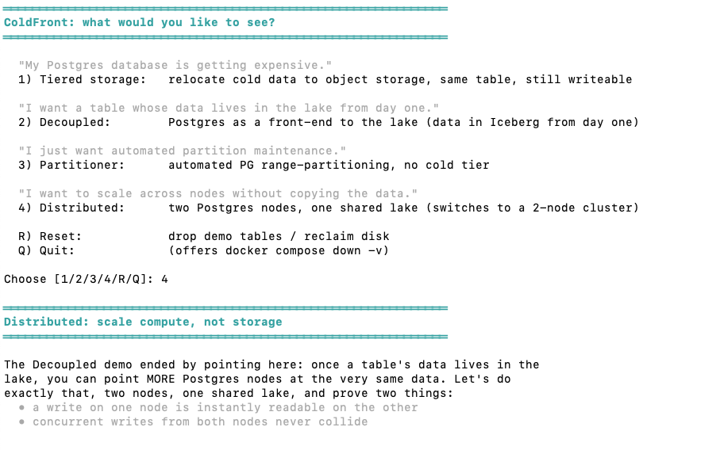
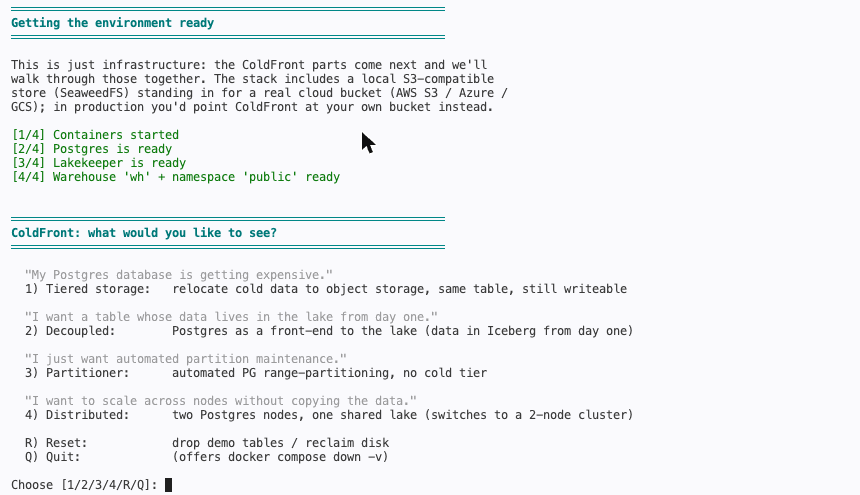

# Exploring Distributed Mode

Distributed mode points two or more PostgreSQL nodes at the *same* lake. The
nodes form an active-active [Spock](https://github.com/pgEdge/spock) mesh, but
they do not each store a copy of the table. The table data is stored once, in
Iceberg, and each node adds query and write capacity over that single shared
copy. Rows that one node writes are readable on the other node as soon as the
write commits, because both nodes read the same files in the lake. When nodes
write to the same table at the same time, ColdFront orders the writes across
the cluster so that the writes never conflict.

This walkthrough uses its own stack, which has two `MESH=on` PostgreSQL nodes
(`db1` and `db2`) that share one Lakekeeper catalog and one object store. Each
step runs SQL on a specific node, so the code blocks on this page do not run in
a Codespace notebook. Run the walkthrough with the interactive guide, or paste
each code block into a psql session on the node that the block names.

The following table shows the four steps this walkthrough performs:

| Step | What you will do |
|------|-----------------|
| [1. Bringing up the two-node mesh](#bringing-up-the-two-node-mesh) | Start the two-node stack and form the Spock mesh. |
| [2. Seeing the mesh](#seeing-the-mesh) | Confirm that both nodes exist and that each subscribes to the other. |
| [3. Writing on one node, reading on the other](#writing-on-one-node-reading-on-the-other) | Create a lake table on `db1` and read its rows on `db2`. |
| [4. Serializing concurrent writes (the bakery)](#serializing-concurrent-writes-the-bakery) | Watch the bakery protocol order cold writes from both nodes so that they never conflict. |

## Running the Interactive Walkthrough on the Command Line

Download the walkthrough files and start the interactive guide as described in
[Running the Interactive Walkthrough on the Command Line](exploring_coldfront/index.md#running-the-interactive-walkthrough-on-the-command-line),
and then choose `4) Distributed` from the guide's menu. The guide describes
each step, shows each command before execution, and waits for you to press
Enter before continuing:



The sections that follow explain each step as the walkthrough executes.
Before the first step, the guide removes the single-node stack and its
volumes, and then brings up the two-node cluster. When the walkthrough ends,
the cluster keeps running; choose another walkthrough from the menu to switch
back to the single-node stack, or choose `Q) Quit`, which offers to remove
everything.

## Running the Walkthrough in a Codespace

In a Codespace, open a terminal and start the interactive guide, then choose
`4) Distributed` from its menu. When the single-node stack is ready, the guide
displays its menu in the Codespace terminal:



The guide then runs the walkthrough as described in
[Running the Interactive Walkthrough on the Command Line](#running-the-interactive-walkthrough-on-the-command-line).
Use the following command to start the guide:

```bash {"ignore":"true"}
bash examples/walkthrough/guide.sh
```

## Running the Walkthrough Manually

Prepare your system as described in
[Running the Walkthrough Manually](exploring_coldfront/index.md#running-the-walkthrough-manually),
and then work from the repository root, or from the `coldfront-walkthrough`
directory if you used the installer. Paste the commands in the sections that
follow into a terminal, and paste the SQL into a psql session on the node that
each code block names. Use the following commands to open a session on each
node:

```bash {"ignore":"true"}
psql "postgresql://coldfront@localhost:5442/coldfront?options=-cclient_min_messages%3Dwarning"   # db1
psql "postgresql://coldfront@localhost:5443/coldfront?options=-cclient_min_messages%3Dwarning"   # db2
```

Start with the first step in the walkthrough,
[Bringing Up the Two-Node Mesh](#bringing-up-the-two-node-mesh), which starts
the two-node stack.

## Performing the Walkthrough Steps

The following sections explain what each step does and what its output shows.
If you are running the walkthrough manually, paste each code block into a
terminal or a psql session, in order. The interactive guide follows the same
sequence but may combine or skip some steps, so its output can differ from the
output on this page.

### Bringing Up the Two-Node Mesh

Start the mesh stack, and then form the Spock mesh. To form the mesh, create a
node on each member, subscribe each node to the other, and set up the
cold-write coordination on both nodes. First, start the mesh stack and build
its images:

```bash {"ignore":"true"}
docker compose -f examples/walkthrough/docker-compose.mesh.yml up -d --build
```

If port 5442, 5443, 8191, or 8343 is already in use on your host, set
`COLDFRONT_MESH_PG1_PORT`, `COLDFRONT_MESH_PG2_PORT`, `COLDFRONT_MESH_LK_PORT`,
or `COLDFRONT_MESH_S3_PORT` before `up`. The shell commands on this page read
the same variables, so set them in the terminal where you run those commands.
When you open a psql session on a node, connect to the port that you set for
that node.

Next, use the following commands to wait for the mesh's own Lakekeeper,
bootstrap it, and create the `wh` warehouse:

```bash {"ignore":"true"}
# Use the mesh Lakekeeper port (8191 unless you set COLDFRONT_MESH_LK_PORT)
LK_PORT=${COLDFRONT_MESH_LK_PORT:-8191}

# Wait until Lakekeeper is ready to accept requests
until curl -sf "http://localhost:${LK_PORT}/health" >/dev/null; do sleep 2; done

# Bootstrap Lakekeeper (one-time per fresh stack)
curl -sf -X POST http://localhost:${LK_PORT}/management/v1/bootstrap \
  -H 'Content-Type: application/json' \
  -d '{"accept-terms-of-use":true}'

# Create the warehouse (retried by guide.sh until 200)
curl -sf -X POST http://localhost:${LK_PORT}/management/v1/warehouse \
  -H 'Content-Type: application/json' \
  -d '{
    "warehouse-name": "wh",
    "storage-profile": {
      "type": "s3",
      "bucket": "iceberg",
      "region": "us-east-1",
      "endpoint": "http://seaweedfs:8333",
      "path-style-access": true,
      "flavor": "s3-compat",
      "sts-enabled": false,
      "remote-signing-enabled": false
    },
    "storage-credential": {
      "type": "s3",
      "credential-type": "access-key",
      "aws-access-key-id": "admin",
      "aws-secret-access-key": "adminsecret"
    }
  }' \
  || echo "The warehouse create failed - it already exists, or SeaweedFS is not ready yet."
```

Then create the extensions and form the mesh, running each statement on the
node its comment names:

```sql {"ignore":"true"}
-- On BOTH nodes - create the extensions. The container preloads the libraries
-- (shared_preload_libraries) but does not run CREATE EXTENSION, so the SQL
-- objects (the spock schema, coldfront functions) do not exist until you do:
CREATE EXTENSION IF NOT EXISTS snowflake;
CREATE EXTENSION IF NOT EXISTS spock;
CREATE EXTENSION IF NOT EXISTS pg_duckdb;
CREATE EXTENSION IF NOT EXISTS coldfront;

-- Create BOTH nodes first: a subscription can only be created once its
-- provider is already a spock node, so both node_create calls must run
-- before either sub_create.
-- On db1:
SELECT spock.node_create('db1', 'host=db1 user=coldfront dbname=coldfront port=5432');
-- On db2:
SELECT spock.node_create('db2', 'host=db2 user=coldfront dbname=coldfront port=5432');
-- Then subscribe each node to the other (order between these two does not matter):
-- On db1:
SELECT spock.sub_create('sub_db1_from_db2', 'host=db2 user=coldfront dbname=coldfront port=5432');
-- On db2:
SELECT spock.sub_create('sub_db2_from_db1', 'host=db1 user=coldfront dbname=coldfront port=5432');

-- On BOTH nodes - wait for the subscription to sync, then put the replicated
-- ColdFront tables in the repset and set the cold-store secret, before any
-- cold write:
SELECT spock.sub_wait_for_sync(sub_name) FROM spock.subscription;
SELECT coldfront.ensure_replicated();
SELECT coldfront.set_storage_secret('admin', 'adminsecret', 'seaweedfs:8333');
```

The nodes reach each other over the Compose network (service names `db1`/`db2`,
port 5432). The bakery replicates only small coordination metadata between
nodes, never the table data, which stays in the lake. The `set_storage_secret`
call is what lets each node's DuckDB write Parquet to the shared object store;
without it, cold writes fail to authenticate.

### Seeing the Mesh

Use the following query to confirm that both nodes exist and that each
subscribes to the other:

```sql {"ignore":"true"}
SELECT node_name FROM spock.node ORDER BY node_name;   -- db1, db2
SELECT sub_name  FROM spock.subscription;              -- one per node
```

### Writing on One Node, Reading on the Other

Create the `public` namespace in the shared catalog, once, from either node:

```sql {"ignore":"true"}
-- On db1:
SELECT coldfront.create_iceberg_namespace('public');
```

Use the following call to create a lake-native table on `db1`, and then run the
same call on `db2`. The call is idempotent, and the registry is keyed by table
name, so each node ends up with an identical local view:

```sql {"ignore":"true"}
-- On db1, then on db2 - same call:
SELECT coldfront.create_iceberg_table(
  'public', 'events_lake',
  '[{"name":"id","type":"bigint"},{"name":"ts","type":"timestamptz"},
    {"name":"status","type":"text"},{"name":"data","type":"jsonb"}]'::jsonb
);
```

Use the following statements to write three rows on `db1` and read them back on
`db2`:

```sql {"ignore":"true"}
-- db1:
INSERT INTO events_lake VALUES
  (1, now(), 'ok',   '{"n":"db1"}'),
  (2, now(), 'ok',   '{"n":"db1"}'),
  (3, now(), 'warn', '{"n":"db1"}');

-- db2 - a different node, which stored none of this data:
SELECT id, status, data->>'n' AS written_by FROM events_lake ORDER BY id;
SELECT relkind, pg_size_pretty(pg_relation_size('events_lake')) AS pg_bytes
FROM pg_class WHERE relname = 'events_lake';   -- v, 0 bytes
```

`db2` returns every row that `db1` wrote and stores zero bytes for the table,
because `db2` reads the rows directly from the shared lake. In distributed
mode, each node that you add contributes compute over one copy of the data,
with no storage to replicate.

### Serializing Concurrent Writes (The Bakery)

When two nodes commit to the same Iceberg table at the same time, the catalog
normally rejects the second commit with a `409 Conflict`, and the application
has to retry. ColdFront's bakery protocol prevents the conflict. Each cold
write takes a globally ordered ticket, which Spock replicates to every node,
and waits its turn. The TLA+ model under `docs/formal/` verifies the protocol.

An `INSERT` adds new data files without changing existing rows. The `INSERT`
uploads its Parquet files first and takes a claim on the table only for the
commit. An `UPDATE`, `DELETE` or `MERGE` changes rows that already exist in the
lake. These statements take the claim before reading the rows and hold the
claim until the transaction commits.

The bookkeeping is ordinary rows in `coldfront.claims` and
`coldfront.claim_acks`, and a write's commit clears them. To read these rows,
run an `UPDATE` in one session on `db1` and leave the transaction open:

```sql {"ignore":"true"}
BEGIN;
UPDATE events_lake SET status = 'held' WHERE id = 3;
-- leave the transaction open
```

Open a second session, and run the following query on `db1` and then on `db2`.
Both nodes return the same claim row. The ticket is a Snowflake ID that also
names the issuing node. ColdFront writes the claim over a separate connection
and commits it at once, so the claim replicates while the transaction that
took it is still open:

```sql {"ignore":"true"}
-- On db1, then on db2 - the same row on both:
SELECT ticket, snowflake.get_node(ticket) AS issued_by_node, iceberg_table
FROM coldfront.claims;
```

`db2` acknowledges the ticket and the ack replicates back. A writer commits
only once every peer has acked its ticket, which is what orders writers across
nodes (the Ricart-Agrawala rule):

```sql {"ignore":"true"}
-- On db1:
SELECT ticket, ack_from_name AS acked_by FROM coldfront.claim_acks;
```

The change is not in the lake yet, because the commit writes the Iceberg
snapshot under the claim. Use the following query to confirm that the row with
`id = 3` still has the status `warn` on `db2`:

```sql {"ignore":"true"}
-- On db2:
SELECT id, status FROM events_lake WHERE id = 3;   -- 3 | warn
```

Next, run `COMMIT` in the first session on `db1`. The release deletes the claim
and its acks, both deletes replicate, and `db2` reads the new status:

```sql {"ignore":"true"}
-- On db2:
SELECT (SELECT count(*) FROM coldfront.claims)       AS claims,
       (SELECT count(*) FROM coldfront.claim_acks)   AS acks,
       (SELECT status FROM events_lake WHERE id = 3) AS status_of_id_3;
-- 0 | 0 | held
```

Tickets are never reused, so an empty ledger is the steady state between
writes.

If you brought up the mesh with the interactive guide, the guide may have
published the nodes on other ports. Use the following commands to set the port
variables from the running mesh before you run the loop:

```bash {"ignore":"true"}
export COLDFRONT_MESH_PG1_PORT=$(docker compose \
  -f examples/walkthrough/docker-compose.mesh.yml port db1 5432 | cut -d: -f2)
export COLDFRONT_MESH_PG2_PORT=$(docker compose \
  -f examples/walkthrough/docker-compose.mesh.yml port db2 5432 | cut -d: -f2)
```

To see the protocol order concurrent writes, run several `INSERT` statements
at the same time on both nodes, for example five on `db1` (IDs 101 to 105) and
five on `db2` (IDs 201 to 205). The following loop starts the ten writes in
parallel, as the interactive guide does:

```bash {"ignore":"true"}
for i in 1 2 3 4 5; do
  psql "postgresql://coldfront@localhost:${COLDFRONT_MESH_PG1_PORT:-5442}/coldfront?options=-cclient_min_messages%3Dwarning" -c \
    "INSERT INTO events_lake VALUES (10$i, now(), 'storm', '{\"n\":\"db1\"}');" &
  psql "postgresql://coldfront@localhost:${COLDFRONT_MESH_PG2_PORT:-5443}/coldfront?options=-cclient_min_messages%3Dwarning" -c \
    "INSERT INTO events_lake VALUES (20$i, now(), 'storm', '{\"n\":\"db2\"}');" &
done
wait
```

Every write lands, with no conflicts and no application-level retry. Two layers
serialize them. A node-local advisory lock keeps one cold writer per node in
the bakery at a time, and the cross-node Ricart-Agrawala claim protocol orders
writers across nodes. The durable record is the lake's own; every commit adds
one snapshot to the table's metadata, in a single chain of sequence numbers.
Resolve the table's metadata location from the mesh stack's Lakekeeper, as in
the tiered walkthrough, and list the history from either node:

```bash {"ignore":"true"}
LK_PORT=${COLDFRONT_MESH_LK_PORT:-8191}
WH_ID=$(curl -s "http://localhost:${LK_PORT}/management/v1/warehouse" \
  | grep -o '"warehouse-id":"[^"]*"' | head -1 | cut -d'"' -f4)
META_LOC=$(curl -s \
  "http://localhost:${LK_PORT}/catalog/v1/${WH_ID}/namespaces/public/tables/events_lake" \
  -H 'accept: application/json' \
  | grep -o '"metadata-location":"[^"]*"' | head -1 | cut -d'"' -f4)

psql "postgresql://coldfront@localhost:${COLDFRONT_MESH_PG2_PORT:-5443}/coldfront?options=-cclient_min_messages%3Dwarning" -P pager=off <<SQL
SELECT sequence_number, snapshot_id, timestamp_ms
FROM iceberg_snapshots('${META_LOC}')
ORDER BY sequence_number;
SQL
```

Twelve writes from two nodes produce twelve snapshots, with no missing sequence
number and no fork.

## When You Finish

To stop the two-node stack and remove its data, run the following command:

```bash
docker compose \
  -f examples/walkthrough/docker-compose.mesh.yml \
  down -v
```

The `-v` flag removes the stack's data volumes; omit the flag to keep the data
for a later session. To start that session, run the command in
[Bringing Up the Two-Node Mesh](#bringing-up-the-two-node-mesh), not the
interactive guide; the guide's distributed walkthrough removes both stacks'
data volumes before it starts.

## Next Steps

To go further with ColdFront, consult the following guides:

- The [Exploring the Standalone Partitioner](walkthrough_partitioner.md)
  walkthrough manages PostgreSQL range partitions without any cold tier.
- The [Using ColdFront](using_coldfront/index.md) guide compares the tiered,
  decoupled, and standalone partitioned modes, and covers dropping Iceberg
  tables and the partition management CLI.
- The [Architecture](architecture_guides/index.md) overview explains the shared mechanics
  and links to the per-mode deep dives.
- The [Compaction](compaction.md) guide covers cold-tier maintenance:
  compaction, snapshot expiry, and orphan-file removal.
