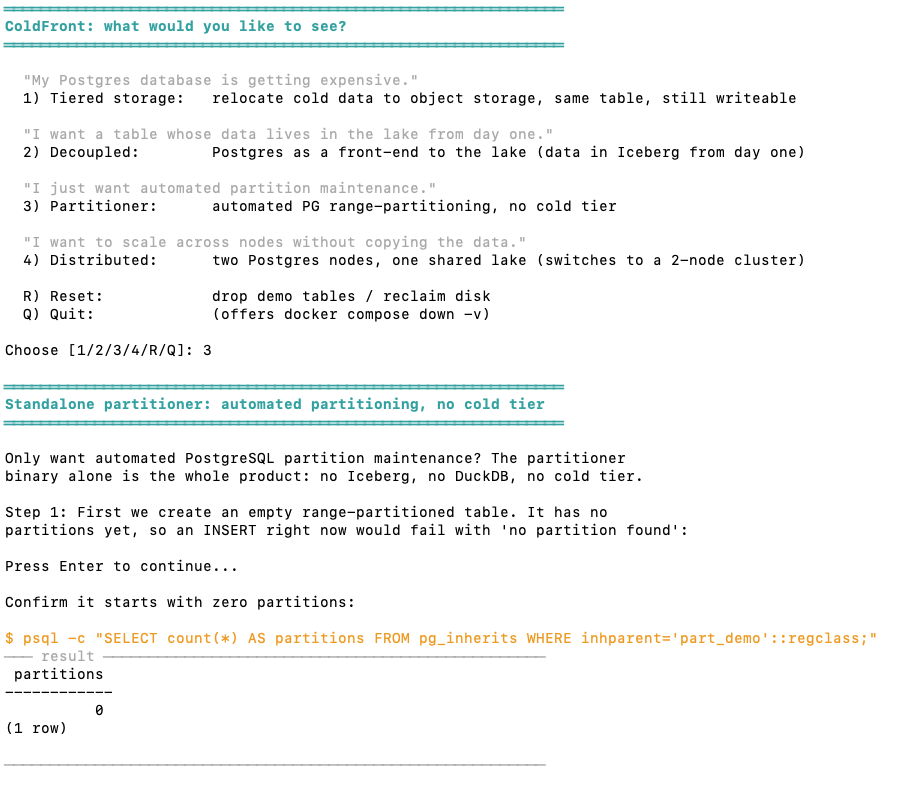
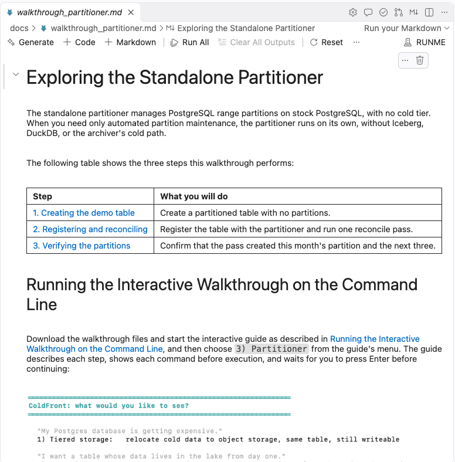
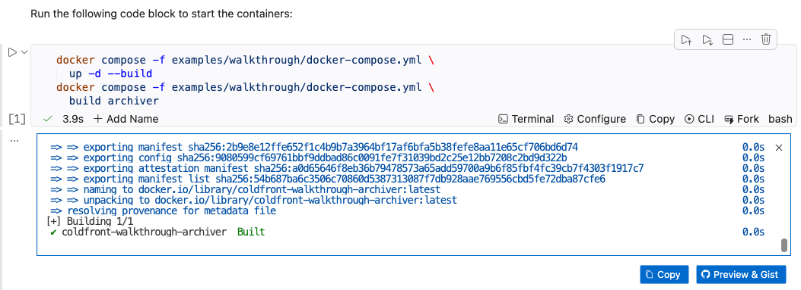

# Exploring the Standalone Partitioner

The standalone partitioner manages PostgreSQL range partitions on stock
PostgreSQL, with no cold tier. When you need only automated partition
maintenance, the partitioner runs on its own, without Iceberg, DuckDB, or the
archiver's cold path.

The following table shows the three steps this walkthrough performs:

| Step | What you will do |
|------|-----------------|
| [1. Creating the demo table](#creating-the-demo-table) | Create a partitioned table with no partitions. |
| [2. Registering and reconciling](#registering-and-reconciling) | Register the table with the partitioner and run one reconcile pass. |
| [3. Verifying the partitions](#verifying-the-partitions) | Confirm that the pass created this month's partition and the next three. |

## Running the Interactive Walkthrough on the Command Line

Download the walkthrough files and start the interactive guide as described in
[Running the Interactive Walkthrough on the Command Line](exploring_coldfront/index.md#running-the-interactive-walkthrough-on-the-command-line),
and then choose `3) Partitioner` from the guide's menu. The guide describes
each step, shows each command before execution, and waits for you to press
Enter before continuing:



The sections that follow explain each step as the walkthrough executes.
When the walkthrough ends, the guide offers to drop the `part_demo` table
before returning to the menu.

## Running the Walkthrough in a Codespace

Create the Codespace as described in
[Running the Walkthrough in a Codespace](exploring_coldfront/index.md#running-the-walkthrough-in-a-codespace).
The Codespace opens the Exploring ColdFront page; click Exploring the
Standalone Partitioner to open this page as a notebook:



To run a code block, click the triangle to the left of the code block.

<div class="admonition hint">
<p class="admonition-title">Hint</p>
<p>The first time you start the stack, Docker builds the images, which can take
several minutes. If you start the stack again, Docker reuses the images and the
stack starts within a minute.</p>
</div>

Run the following code block to start the containers:

```bash
docker compose -f examples/walkthrough/docker-compose.yml \
  up -d --build
docker compose -f examples/walkthrough/docker-compose.yml \
  build archiver
```

When the code block finishes, a check mark and the run time appear under the
commands, and the Compose output appears below the code block:



Then click the triangle beside each code block that follows, in order, starting
with the first step, [Creating the Demo Table](#creating-the-demo-table).

## Running the Walkthrough Manually

If you are using a Codespace, run the code blocks in the previous section
instead of the commands in this section.

Prepare your system as described in
[Running the Walkthrough Manually](exploring_coldfront/index.md#running-the-walkthrough-manually),
and then work from the repository root, or from the `coldfront-walkthrough`
directory if you used the installer.

As you work through the walkthrough:

- paste each shell command into a terminal.
- paste each SQL block into a psql session that you open with
  `psql postgresql://coldfront@localhost:5432/coldfront`.

<div class="admonition hint">
<p class="admonition-title">Hint</p>
<p>The first time you start the stack, Docker builds the images, which can take
several minutes. If you start the stack again, Docker reuses the images and the
stack starts within a minute.</p>
</div>

Use the following commands to start the containers:

```bash {"ignore":"true"}
docker compose -f examples/walkthrough/docker-compose.yml \
  up -d --build
docker compose -f examples/walkthrough/docker-compose.yml \
  build archiver
```

If port 5432, 8181, or 8333 is already in use on your host, see
[Changing Port Assignments](exploring_coldfront/index.md#changing-port-assignments).

When the stack is running, continue with the first step,
[Creating the Demo Table](#creating-the-demo-table).

## Performing the Walkthrough Steps

Every method of running the walkthrough performs the following steps in
order. If you are running the walkthrough manually, paste each code block into
a terminal or a psql session. If you are using the interactive guide or a
Codespace, the following sections explain what each step does and what its
output shows.

### Creating the Demo Table

Use the following statements to create a range-partitioned table that has no
partitions yet. Until a partition exists, an `INSERT` into the table fails:

```sql {"interpreter":"psql postgresql://coldfront@localhost:5432/coldfront?options=-cclient_min_messages%3Dwarning -v ON_ERROR_STOP=1 -P pager=off -f"}
SET search_path = public;

CREATE TABLE part_demo (
    id   bigint GENERATED ALWAYS AS IDENTITY,
    ts   timestamptz NOT NULL,
    note text,
    PRIMARY KEY (id, ts)
) PARTITION BY RANGE (ts);
```

### Registering and Reconciling

Use the following commands to register the table with the partitioner and run
one reconcile pass. The registration sets a monthly period and a 12-month
retention. Both commands run in a container on the Compose network and connect
to the `db` service:

```bash
# Register the table.
docker compose \
  -f examples/walkthrough/docker-compose.yml \
  run --rm --no-deps --entrypoint partitioner archiver \
  register \
  --table part_demo \
  --period monthly \
  --retention "12 months"

# Run a reconcile pass to premake forward partitions.
docker compose \
  -f examples/walkthrough/docker-compose.yml \
  run --rm --no-deps --entrypoint partitioner archiver
```

The partitioner does not need a configuration file. The partitioner reads its
connection settings from the `PG*` environment variables that the Compose
service sets, and reads its list of tables from `coldfront.partition_config`.

### Verifying the Partitions

Each reconcile pass ensures that a partition covering today exists and creates
the next three monthly partitions; three is the default for
`register --premake`. Each pass also drops any partition older than the
retention period. Use the following query to count the partitions that the
pass created:

```sql {"interpreter":"psql postgresql://coldfront@localhost:5432/coldfront?options=-cclient_min_messages%3Dwarning -v ON_ERROR_STOP=1 -P pager=off -f"}
SELECT count(*) AS partitions
FROM pg_inherits
WHERE inhparent = 'part_demo'::regclass;
```

The query returns 4, one partition for the current month and one for each of
the next three months.

A table registered with `--strategy detach` keeps its expired partitions as
standalone tables instead of dropping them. The
[Managing Partitioned Tables (CLI)](using_coldfront/index.md#managing-partitioned-tables-cli)
section describes the partition CLI and shows more `register` examples.

## When You Finish

When you finish the walkthrough, use the following command to stop the stack
and remove its data. The tiered, decoupled, and partitioner walkthroughs share
this stack and its data volumes, so removing the data means the next
walkthrough you run starts fresh:

```bash
docker compose \
  -f examples/walkthrough/docker-compose.yml \
  down -v
```

The `-v` flag removes the stack's data volumes; omit the flag to keep the data
for a later session.

## Next Steps

To go further with ColdFront, consult the following guides:

- The [Using ColdFront](using_coldfront/index.md) guide compares the tiered,
  decoupled, and standalone partitioned modes, and covers dropping Iceberg
  tables and the partition management CLI.
- The [Architecture](architecture_guides/index.md) overview explains the shared
  mechanics and links to the per-mode deep dives.
