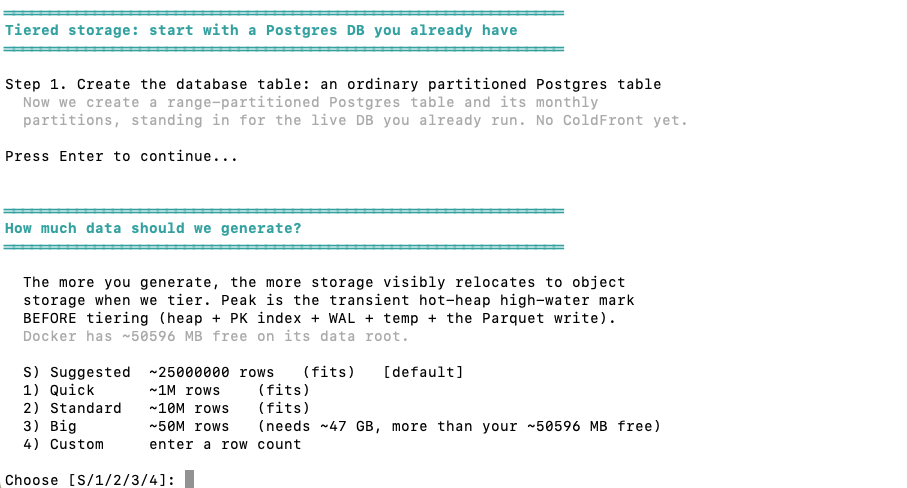
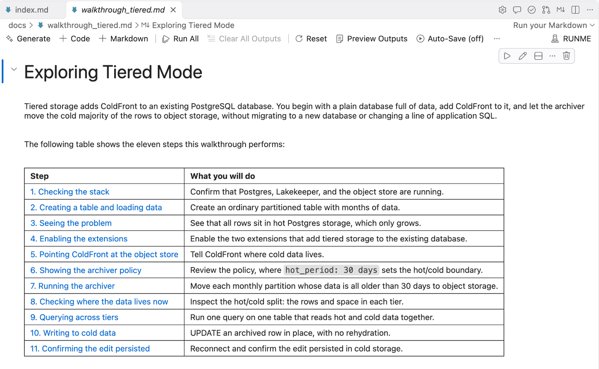
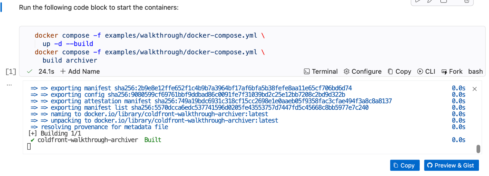
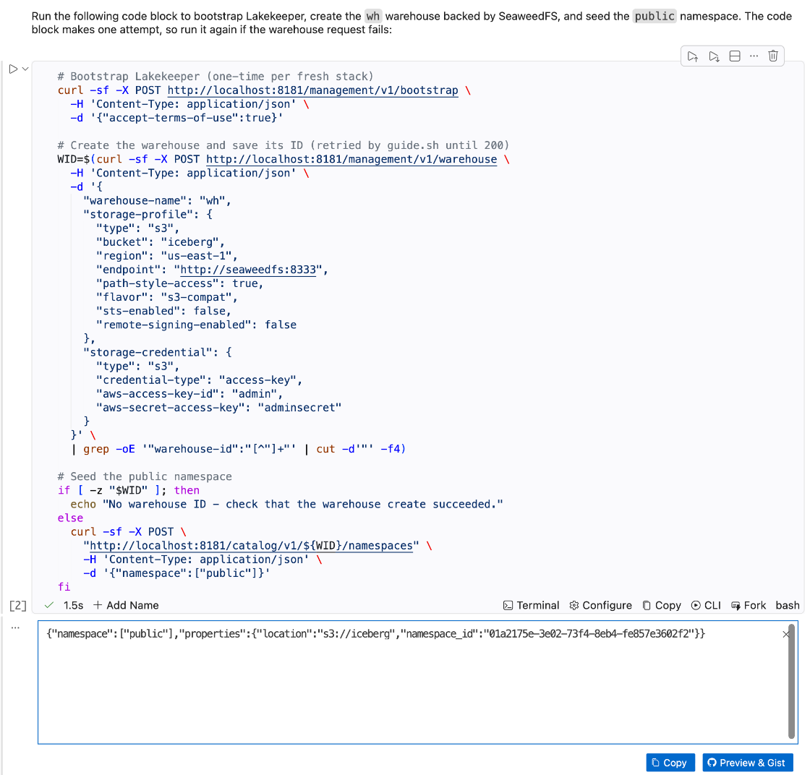

# Exploring Tiered Mode

Tiered storage adds ColdFront to an existing PostgreSQL database. You begin
with a plain database full of data, add ColdFront to it, and let the archiver
move the cold majority of the rows to object storage, without migrating to a
new database or changing a line of application SQL.

The following table shows the eleven steps this walkthrough performs:

| Step | What you will do |
|------|-----------------|
| [1. Checking the stack](#checking-the-stack) | Confirm that Postgres, Lakekeeper, and the object store are running. |
| [2. Creating a table and loading data](#creating-a-table-and-loading-data) | Create an ordinary partitioned table with months of data. |
| [3. Seeing the problem](#seeing-the-problem) | See that all rows sit in hot Postgres storage, which only grows. |
| [4. Enabling the extensions](#enabling-the-extensions) | Enable the two extensions that add tiered storage to the existing database. |
| [5. Pointing ColdFront at the object store](#pointing-coldfront-at-the-object-store) | Tell ColdFront where cold data lives. |
| [6. Showing the archiver policy](#showing-the-archiver-policy) | Review the policy, where `hot_period: 30 days` sets the hot/cold boundary. |
| [7. Running the archiver](#running-the-archiver) | Move each monthly partition whose data is all older than 30 days to object storage. |
| [8. Checking where the data lives now](#checking-where-the-data-lives-now) | Inspect the hot/cold split: the rows and space in each tier. |
| [9. Querying across tiers](#querying-across-tiers) | Run one query on one table that reads hot and cold data together. |
| [10. Writing to cold data](#writing-to-cold-data) | UPDATE an archived row in place, with no rehydration. |
| [11. Confirming the edit persisted](#confirming-the-edit-persisted) | Reconnect and confirm the edit persisted in cold storage. |

## Running the Interactive Walkthrough on the Command Line

Download the walkthrough files and start the interactive guide as described in
[Running the Interactive Walkthrough on the Command Line](exploring_coldfront/index.md#running-the-interactive-walkthrough-on-the-command-line),
and then choose `1) Tiered storage` from the guide's menu. The guide describes
each step, shows each command before execution, and waits for you to press
Enter before continuing.

After the first step, the guide asks how much data to generate. The row
counts and sizes in the guide's output depend on that choice, so they differ
from the output that this page describes:



The sections that follow explain each step as the walkthrough executes. When
the walkthrough ends, the guide offers to drop the tables that the walkthrough
created before returning to the menu.

## Running the Walkthrough in a Codespace

Create the Codespace as described in
[Running the Walkthrough in a Codespace](exploring_coldfront/index.md#running-the-walkthrough-in-a-codespace).
The Codespace opens the Exploring ColdFront page; click Exploring Tiered
Mode to open this page as a notebook:



Run the first code block to start the containers. To run a code block, click
the triangle to the left of the code block. When the code block finishes, a
check mark and the run time appear under the commands, and the Compose output
appears below the code block:



Commands in the first code block build the images, start PostgreSQL,
Lakekeeper, and SeaweedFS in the background, and build the archiver image,
which the walkthrough uses later to move cold data:

```bash
docker compose -f examples/walkthrough/docker-compose.yml \
  up -d --build
docker compose -f examples/walkthrough/docker-compose.yml \
  build archiver
```

Run the second code block to prepare Lakekeeper, the Iceberg catalog. When the
bootstrap succeeds, the output displays the new `public` namespace:



The code block bootstraps Lakekeeper, creates the `wh` warehouse that stores
its tables in SeaweedFS, and creates the `public` namespace in that warehouse.
The code block makes one attempt, so run the block again if the warehouse
request fails:

```bash
# Bootstrap Lakekeeper (one-time per fresh stack)
curl -sf -X POST http://localhost:8181/management/v1/bootstrap \
  -H 'Content-Type: application/json' \
  -d '{"accept-terms-of-use":true}'

# Create the warehouse and save its ID (retried by guide.sh until 200)
WID=$(curl -sf -X POST http://localhost:8181/management/v1/warehouse \
  -H 'Content-Type: application/json' \
  -d '{
    "warehouse-name": "wh",
    "storage-profile": {
      "type": "s3",
      "bucket": "iceberg",
      "region": "us-east-1",
      "endpoint": "http://seaweedfs:8333",
      "path-style-access": true,
      "flavor": "s3-compat",
      "sts-enabled": false,
      "remote-signing-enabled": false
    },
    "storage-credential": {
      "type": "s3",
      "credential-type": "access-key",
      "aws-access-key-id": "admin",
      "aws-secret-access-key": "adminsecret"
    }
  }' \
  | grep -oE '"warehouse-id":"[^"]+"' | cut -d'"' -f4)

# Seed the public namespace
if [ -z "$WID" ]; then
  echo "No warehouse ID - check that the warehouse create succeeded."
else
  curl -sf -X POST \
    "http://localhost:8181/catalog/v1/${WID}/namespaces" \
    -H 'Content-Type: application/json' \
    -d '{"namespace":["public"]}'
fi
```

Then click the triangle beside each code block that follows, in order, starting
with the first step in the walkthrough,
[Checking the Stack](#checking-the-stack).

## Running the Walkthrough Manually

If you are using a Codespace, run the code blocks in the previous section
instead of the commands in this section.

Prepare your system as described in
[Running the Walkthrough Manually](exploring_coldfront/index.md#running-the-walkthrough-manually),
and then work from the repository root, or from the `coldfront-walkthrough`
directory if you used the installer.

As you work through the walkthrough:

- paste each shell command into a terminal.
- paste each SQL block into a psql session that you open with the following
  command, which hides the informational notices that pg_duckdb prints:
  `psql "postgresql://coldfront@localhost:5432/coldfront?options=-cclient_min_messages%3Dwarning"`.

Use the following commands to start the containers and then bootstrap
Lakekeeper:

```bash {"ignore":"true"}
docker compose -f examples/walkthrough/docker-compose.yml \
  up -d --build
docker compose -f examples/walkthrough/docker-compose.yml \
  build archiver
```

```bash {"ignore":"true"}
# Bootstrap Lakekeeper (one-time per fresh stack)
curl -sf -X POST http://localhost:8181/management/v1/bootstrap \
  -H 'Content-Type: application/json' \
  -d '{"accept-terms-of-use":true}'

# Create the warehouse and save its ID (retried by guide.sh until 200)
WID=$(curl -sf -X POST http://localhost:8181/management/v1/warehouse \
  -H 'Content-Type: application/json' \
  -d '{
    "warehouse-name": "wh",
    "storage-profile": {
      "type": "s3",
      "bucket": "iceberg",
      "region": "us-east-1",
      "endpoint": "http://seaweedfs:8333",
      "path-style-access": true,
      "flavor": "s3-compat",
      "sts-enabled": false,
      "remote-signing-enabled": false
    },
    "storage-credential": {
      "type": "s3",
      "credential-type": "access-key",
      "aws-access-key-id": "admin",
      "aws-secret-access-key": "adminsecret"
    }
  }' \
  | grep -oE '"warehouse-id":"[^"]+"' | cut -d'"' -f4)

# Seed the public namespace
if [ -z "$WID" ]; then
  echo "No warehouse ID - check that the warehouse create succeeded."
else
  curl -sf -X POST \
    "http://localhost:8181/catalog/v1/${WID}/namespaces" \
    -H 'Content-Type: application/json' \
    -d '{"namespace":["public"]}'
fi
```

If port 5432, 8181, or 8333 is already in use on your host, see
[Changing Port Assignments](exploring_coldfront/index.md#changing-port-assignments).

When the stack is running, continue with the first step in the walkthrough,
[Checking the Stack](#checking-the-stack).

## Performing the Walkthrough Steps

The following sections explain what each step does and what its output shows.
If you are running the walkthrough manually, paste each code block into a
terminal or a psql session, in order. The interactive guide follows the same
sequence but may combine or skip some steps, so its output can differ from the
output on this page.

### Checking the Stack

The stack runs PostgreSQL, the Lakekeeper catalog, and the SeaweedFS object
store; the catalog and the object store form the cold-storage side. The
cold-storage side sits idle until you point ColdFront at it in
[Step 5](#pointing-coldfront-at-the-object-store) (Pointing ColdFront at the
Object Store). Use the following command to confirm that the `db`,
`lakekeeper-db`, and `lakekeeper` services report `healthy`:

```bash
docker compose -f examples/walkthrough/docker-compose.yml ps
```

<div class="admonition hint">
<p class="admonition-title">Hint</p>
<p>In production, the object store is AWS S3, GCS, Azure ADLS Gen2, or another
S3-compatible store.</p>
</div>

### Creating a Table and Loading Data

In this step, you create an ordinary range-partitioned PostgreSQL table and
fill the table with months of sample data. The table stands in for a table in
a database that you already run; nothing in this step is specific to
ColdFront.

Create the partitioned table with 25 monthly partitions covering about two
years of history plus the current month:

```sql {"interpreter":"psql postgresql://coldfront@localhost:5432/coldfront?options=-cclient_min_messages%3Dwarning -v ON_ERROR_STOP=1 -P pager=off -f"}
SET search_path = public;

CREATE TABLE events (
    id     bigint GENERATED BY DEFAULT AS IDENTITY,
    ts     timestamptz NOT NULL,
    status text,
    data   jsonb,
    PRIMARY KEY (id, ts)
) PARTITION BY RANGE (ts);

DO $do$
DECLARE m date;
BEGIN
  FOR i IN 0..24 LOOP
    m := (
      date_trunc('month', now())
      - make_interval(months => 24 - i)
    )::date;
    EXECUTE format(
      'CREATE TABLE IF NOT EXISTS %I'
      ' PARTITION OF events'
      ' FOR VALUES FROM (%L) TO (%L)',
      'events_p_' || to_char(m, 'YYYY_MM'),
      m,
      (m + interval '1 month')
    );
  END LOOP;
END $do$;
```

Months older than 30 days will tier to cold; the last month or two stays hot.

Insert approximately one million rows spread evenly across the partition window
(roughly two years, 730 days, from `now()`):

```sql {"interpreter":"psql postgresql://coldfront@localhost:5432/coldfront?options=-cclient_min_messages%3Dwarning -v ON_ERROR_STOP=1 -P pager=off -f"}
INSERT INTO events (id, ts, status, data)
SELECT i,
       now() - ((1000000 - i) * (interval '730 days' / 1000000)),
       (ARRAY['ok','warn','error'])[1 + i % 3],
       jsonb_build_object('level', (ARRAY['info','warn','error'])[1 + i % 3],
                          'region', 'us-east-1', 'latency_ms', (i % 500))
FROM generate_series(1, 1000000) i;
```

Use the following query to confirm that the table holds all one million rows:

```sql {"interpreter":"psql postgresql://coldfront@localhost:5432/coldfront?options=-cclient_min_messages%3Dwarning -v ON_ERROR_STOP=1 -P pager=off -f"}
SELECT count(*) FROM events;
```

The query returns the row count:

```text {"ignore":"true"}
  count
---------
 1000000
```

Months of data now live in an ordinary PostgreSQL table, with no ColdFront
involved yet.

### Seeing the Problem

This step measures how much hot Postgres storage that data occupies and
confirms that none of it is in lower-cost storage yet. This is the baseline you
will compare against after tiering in
[Step 8](#checking-where-the-data-lives-now) (Checking Where the Data Lives
Now).

`pg_total_relation_size()` on a partitioned parent counts only the empty parent
itself and reports zero. Sum across `pg_partition_tree` to get the true heap
size:

```sql {"interpreter":"psql postgresql://coldfront@localhost:5432/coldfront?options=-cclient_min_messages%3Dwarning -v ON_ERROR_STOP=1 -P pager=off -f"}
SELECT pg_size_pretty(
    pg_total_relation_size('events') +
    COALESCE((
        SELECT sum(pg_total_relation_size(relid))
        FROM pg_partition_tree('events')
        WHERE relid <> 'events'::regclass
    ), 0)
) AS hot_size;
```

The query returns:

```text {"ignore":"true"}
 hot_size
----------
 152 MB
```

All one million rows occupy hot, expensive primary storage, and the table only
grows. Remember this figure for comparison after tiering.

### Enabling the Extensions

This step adds tiered storage to the existing database by creating two
extensions. `pg_duckdb` gives PostgreSQL an in-process engine that can read
Parquet files in object storage. `coldfront` adds the layer that routes each
query to the right tier and rewrites DML. The extensions install into the
running database, with no migration and no new database.

Run the following SQL to create both extensions:

```sql {"interpreter":"psql postgresql://coldfront@localhost:5432/coldfront?options=-cclient_min_messages%3Dwarning -v ON_ERROR_STOP=1 -P pager=off -f"}
CREATE EXTENSION IF NOT EXISTS pg_duckdb;
CREATE EXTENSION IF NOT EXISTS coldfront;
```

Confirm both are installed:

```sql {"interpreter":"psql postgresql://coldfront@localhost:5432/coldfront?options=-cclient_min_messages%3Dwarning -v ON_ERROR_STOP=1 -P pager=off -f"}
\dx
```

The output lists both:

```text {"ignore":"true"}
                                                            List of installed extensions
   Name    | Version | Default version |   Schema   |                                          Description
-----------+---------+-----------------+------------+------------------------------------------------------------------------------------------------
 coldfront | 1.0     | 1.0             | coldfront  | Transparent tiered storage: route DML on tiered views across hot (PG) and cold (Iceberg) tiers
 pg_duckdb | 1.1.0   | 1.1.0           | public     | DuckDB Embedded in Postgres
 plpgsql   | 1.0     | 1.0             | pg_catalog | PL/pgSQL procedural language
(3 rows)
```

The two extensions are the entire ColdFront installation. There is no sidecar,
no proxy, and no data movement yet.

### Pointing ColdFront at the Object Store

This step tells ColdFront where cold data goes and how to authenticate to it.
The credentials below are throwaway values for the local SeaweedFS emulator.

Register the local SeaweedFS credentials:

```sql {"interpreter":"psql postgresql://coldfront@localhost:5432/coldfront?options=-cclient_min_messages%3Dwarning -v ON_ERROR_STOP=1 -P pager=off -f"}
SELECT coldfront.set_storage_secret(
  'admin', 'adminsecret', 'seaweedfs:8333'
);
```

With the credential stored, confirm the warehouse that setup created (`wh`)
exists:

```bash
curl -s localhost:8181/management/v1/warehouse \
  | grep -o '"name":"wh"'
```

The response confirms that the warehouse exists:

```text {"ignore":"true"}
"name":"wh"
```

### Showing the Archiver Policy

The archiver policy is one rule in a YAML file. Data older than 30 days belongs
in low-cost object storage; the most recent data stays hot in PostgreSQL.
Nothing moves yet; this step shows only the boundary.

Use the following command to inspect the archiver configuration:

```bash
cat examples/walkthrough/config/archiver.yaml
```

The file reads:

```yaml {"ignore":"true"}
# ColdFront walkthrough archiver config: Demo 1 (tiered).
#
# An import input: `docker compose run --rm --no-deps archiver import --config
# /config/archiver.yaml` writes it into the server once, the table into
# coldfront.partition_config and the store into coldfront.storage_secret. The
# archiver then runs with no file, connecting from the PG* environment the
# compose service sets. Endpoints are compose SERVICE NAMES, since the archiver
# runs inside the compose network. hot_period "30 days" keeps the current month
# hot and tiers the older months to Iceberg/S3, deterministic because the
# walkthrough seeds now()-relative timestamps.
s3:
    endpoint: "seaweedfs:8333"
    region: "us-east-1"
    access_key: "admin"
    secret_key: "adminsecret"
    use_ssl: false
    url_style: "path"
archiver:
    tables:
        - source_table: events
          partition_period: monthly
          hot_period: "30 days"
```

The `hot_period: 30 days` value is the hot/cold line. Any partition whose data
is entirely older than 30 days will move to object storage when the archiver
runs.

### Running the Archiver

The archiver reads its configuration from the server. The `import` command
writes the YAML into the server once; the table goes into
`coldfront.partition_config`, and the store goes into
`coldfront.storage_secret`. Then run the archiver, which connects from the
`PG*` environment the compose service sets and needs no file. The archiver
moves every partition older than 30 days out of the PostgreSQL heap into
Parquet files in object storage, and rebuilds `events` as a unified view over
the hot remainder and the cold data.

The following commands import the table and run the archiver:

```bash
docker compose \
  -f examples/walkthrough/docker-compose.yml \
  run --rm --no-deps archiver import --config /config/archiver.yaml

docker compose \
  -f examples/walkthrough/docker-compose.yml \
  run --rm --no-deps archiver
```

The `--no-deps` flag reuses the already-running, data-loaded `db` container;
without it, `docker compose run` re-evaluates `depends_on` and can recreate
`db` from its config hash, restarting the database in the middle of the
walkthrough (the `pgdata` volume keeps the rows).

The archiver connects inside the Compose network (service name `db`, not
`localhost`), detaches the partitions older than 30 days from PostgreSQL,
exports them to Iceberg via pg_duckdb, and replaces the `events` table with a
unified view that queries both tiers.

#### Confirming That the Cold Rows Are in S3 as Parquet

The `iceberg_metadata()` table function resolves its argument as a filesystem
path, so a REST-catalog table cannot be addressed by name directly. Resolve the
table's `metadata.json` S3 location from the Lakekeeper catalog first, then
point `iceberg_metadata()` at that path:

```bash
# Resolve the warehouse id and the table's metadata location.
WH_ID=$(curl -s http://localhost:8181/management/v1/warehouse \
  | grep -o '"warehouse-id":"[^"]*"' \
  | head -1 | cut -d'"' -f4)

META_LOC=$(curl -s \
  "http://localhost:8181/catalog/v1/${WH_ID}/namespaces/public/tables/events" \
  -H 'accept: application/json' \
  | grep -o '"metadata-location":"[^"]*"' \
  | head -1 | cut -d'"' -f4)

echo "$META_LOC"

# Query the Parquet data files registered in that Iceberg snapshot.
psql "postgresql://coldfront@localhost:5432/coldfront" \
  -v ON_ERROR_STOP=1 -P pager=off <<SQL
SELECT file_path
FROM iceberg_metadata('${META_LOC}')
WHERE file_path LIKE '%.parquet'
LIMIT 3;
SQL
```

The query returns:

```text {"ignore":"true"}
s3://iceberg/<table-uuid>/metadata/00023-<uuid>.gz.metadata.json

 file_path
-----------------------------------------------------------------
 s3://iceberg/.../data/month_ts_2=656/01a0ec3d-8abb-....parquet
 s3://iceberg/.../data/month_ts_2=657/01a0ec3d-8b52-....parquet
 s3://iceberg/.../data/month_ts_2=658/01a0ec3d-8bd4-....parquet
```

Real `.parquet` objects are in the bucket. The cold rows are no longer in
PostgreSQL; they are objects in object storage. Each month's files sit under
their own `month_ts_<n>=` directory, because the cold table is partitioned by
month, the way the hot table is.

#### Confirming That the Table Changed Shape

Use the following command to inspect the relation type:

```sql {"interpreter":"psql postgresql://coldfront@localhost:5432/coldfront?options=-cclient_min_messages%3Dwarning -v ON_ERROR_STOP=1 -P pager=off -f"}
\d events
```

`events` is now a view. The `_events` table holds only the hot remainder. Run
the following query to see the recorded hot/cold cutoff:

```sql {"interpreter":"psql postgresql://coldfront@localhost:5432/coldfront?options=-cclient_min_messages%3Dwarning -v ON_ERROR_STOP=1 -P pager=off -f"}
SELECT * FROM coldfront.archive_watermark;
```

### Checking Where the Data Lives Now

In this step, you count the rows in each tier after tiering and measure the
space that the hot tier uses. The queries show how many rows are still hot in
PostgreSQL and how many are now cold in object storage, so you can compare the
result with the baseline from [Step 3](#seeing-the-problem) (Seeing the
Problem).

Count the hot rows still in the PostgreSQL heap:

```sql {"interpreter":"psql postgresql://coldfront@localhost:5432/coldfront?options=-cclient_min_messages%3Dwarning -v ON_ERROR_STOP=1 -P pager=off -f"}
SELECT count(*) AS hot_rows FROM _events;
```

Measure the hot heap size by summing over the partition tree:

```sql {"interpreter":"psql postgresql://coldfront@localhost:5432/coldfront?options=-cclient_min_messages%3Dwarning -v ON_ERROR_STOP=1 -P pager=off -f"}
SELECT pg_size_pretty(
    pg_total_relation_size('_events') +
    COALESCE((
        SELECT sum(pg_total_relation_size(relid))
        FROM pg_partition_tree('_events')
        WHERE relid <> '_events'::regclass
    ), 0)
) AS hot_size;
```

Count the total rows across both tiers and derive the cold count:

```sql {"interpreter":"psql postgresql://coldfront@localhost:5432/coldfront?options=-cclient_min_messages%3Dwarning -v ON_ERROR_STOP=1 -P pager=off -f"}
SELECT count(*) AS total_rows FROM events;
```

Together, the three queries give the following hot/cold split:

```text {"ignore":"true"}
  Tier                    Rows         Postgres heap
  ----------------------  -----------  ----------------
  Hot  (Postgres)             ~42,000  ~6.6 MB
  Cold (Parquet in S3)       ~958,000  0 bytes in PG
  ----------------------  -----------  ----------------
  Total                     1,000,000
```

The hot share depends on the day you run the walkthrough. The archiver moves a
monthly partition to cold storage once its end is at least 30 days in the past,
so the previous month stays hot until the 31st. A run on the 1st or the 31st
keeps about 42,000 rows (about 6.6 MB) hot, and a run late in any other month
up to about 83,000 rows (about 12 MB).
Before tiering, the table held one million rows, all hot, in approximately
152 MB of Postgres heap. After tiering, only the last month or two remains in
PostgreSQL; over 90% of the hot storage is gone while the total row count is
unchanged.

### Querying Across Tiers

This step runs one ordinary query against `events` that spans both tiers, then
queries the hot-only table for contrast. The application issuing this query
cannot tell which rows came from the heap and which came from object storage.

Use the following query to read the whole table, hot and cold rows together:

```sql {"interpreter":"psql postgresql://coldfront@localhost:5432/coldfront?options=-cclient_min_messages%3Dwarning -v ON_ERROR_STOP=1 -P pager=off -f"}
SELECT count(*) AS total FROM events;
```

Query only the hot heap:

```sql {"interpreter":"psql postgresql://coldfront@localhost:5432/coldfront?options=-cclient_min_messages%3Dwarning -v ON_ERROR_STOP=1 -P pager=off -f"}
SELECT count(*) AS hot FROM _events;
```

Retrieve specific rows from a cold month:

```sql {"interpreter":"psql postgresql://coldfront@localhost:5432/coldfront?options=-cclient_min_messages%3Dwarning -v ON_ERROR_STOP=1 -P pager=off -f"}
SELECT id, ts, status
FROM events
WHERE ts < date_trunc('month', now()) - interval '3 months'
ORDER BY ts
LIMIT 3;
```

The query returns:

```text {"ignore":"true"}
 id |              ts               | status
----+-------------------------------+--------
  1 | 2024-10-01 14:44:24.687844+00 | warn
  2 | 2024-10-01 14:45:27.759844+00 | error
  3 | 2024-10-01 14:46:30.831844+00 | ok
(3 rows)
```

The timestamps track your load. The rows are 63.072 seconds apart (730 days
divided by one million), and row 1 sits one such step short of 730 days before
the load. It is one table and one query, and no application change is required.

### Writing to Cold Data

This step takes a specific row from a cold (archived) month and updates it
through the same `events` view. Notice what does not happen. The partition is
not rehydrated into PostgreSQL, and there is no ETL job, no restore from
archive, and no second tool.

Capture a cold row's id in a separate query. A sub-select over the tiered view
inside the same DML statement is rejected by the extension, because the rewrite
retargets the leading reference:

```sql {"interpreter":"psql postgresql://coldfront@localhost:5432/coldfront?options=-cclient_min_messages%3Dwarning -v ON_ERROR_STOP=1 -P pager=off -f"}
SELECT id, ts, status
FROM events
WHERE ts < date_trunc('month', now()) - interval '2 months'
ORDER BY ts
LIMIT 1;
```

The query returns:

```text {"ignore":"true"}
 id |              ts               | status
----+-------------------------------+--------
  1 | 2024-10-01 14:44:24.687844+00 | warn
```

Update the archived row through the same table using the captured id:

```sql {"interpreter":"psql postgresql://coldfront@localhost:5432/coldfront?options=-cclient_min_messages%3Dwarning -v ON_ERROR_STOP=1 -P pager=off -f"}
UPDATE events SET status = 'corrected' WHERE id = 1;
```

The statement prints an empty result set, `(0 rows)`, instead of `UPDATE 1`.
The next query shows that the row changed. Read the row back immediately:

```sql {"interpreter":"psql postgresql://coldfront@localhost:5432/coldfront?options=-cclient_min_messages%3Dwarning -v ON_ERROR_STOP=1 -P pager=off -f"}
SELECT id, ts, status FROM events WHERE id = 1;
```

The updated row reads:

```text {"ignore":"true"}
 id |              ts               |  status
----+-------------------------------+-----------
  1 | 2024-10-01 14:44:24.687844+00 | corrected
```

The row's status flipped `warn` to `corrected`. That row is still in object
storage; ColdFront wrote the change directly to object storage.

### Confirming the Edit Persisted

This step opens a fresh `psql` connection (nothing cached from the session that
did the write) and re-checks the row, the total row count, and the hot heap
size. This confirms that the cold edit is durable persistent state and that the
data did not quietly return to PostgreSQL to make the edit possible.

In a Codespace, each code block opens its own connection, and the interactive
guide opens a new session for each check, so neither method needs an extra
step. When you run the walkthrough manually, open a new terminal and start a
new psql session before you run the checks:

```bash {"ignore":"true"}
PGOPTIONS='-c client_min_messages=warning' \
  psql -h localhost -p 5432 -U coldfront -d coldfront
```

Confirm the archived row is still `corrected`:

```sql {"interpreter":"psql postgresql://coldfront@localhost:5432/coldfront?options=-cclient_min_messages%3Dwarning -v ON_ERROR_STOP=1 -P pager=off -f"}
SELECT id, status FROM events WHERE id = 1;
```

The row reads:

```text {"ignore":"true"}
 id |  status
----+-----------
  1 | corrected
(1 row)
```

Confirm the total row count is unchanged:

```sql {"interpreter":"psql postgresql://coldfront@localhost:5432/coldfront?options=-cclient_min_messages%3Dwarning -v ON_ERROR_STOP=1 -P pager=off -f"}
SELECT count(*) AS total_rows FROM events;
```

The count confirms the total is unchanged:

```text {"ignore":"true"}
 total_rows
------------
    1000000
```

Confirm the hot heap is still small (the data did not rehydrate):

```sql {"interpreter":"psql postgresql://coldfront@localhost:5432/coldfront?options=-cclient_min_messages%3Dwarning -v ON_ERROR_STOP=1 -P pager=off -f"}
SELECT pg_size_pretty(
    pg_total_relation_size('_events') +
    COALESCE((
        SELECT sum(pg_total_relation_size(relid))
        FROM pg_partition_tree('_events')
        WHERE relid <> '_events'::regclass
    ), 0)
) AS hot_size;
```

A run on the 1st or the 31st returns about 6.6 MB, and a run late in any other
month about 12 MB:

```text {"ignore":"true"}
 hot_size
----------
 6616 kB
(1 row)
```

In the fresh connection, the archived row is still `corrected`, all one million
rows are present, and the hot heap is still small. The data never came back to
PostgreSQL. Over 90% of the original storage now lives in object storage as
Parquet, and that data is still a normal, writeable part of the table -
corrected in place, no rehydration, no separate system.

## When You Finish

When you finish the walkthrough, use the following command to stop the stack
and remove its data. The tiered, decoupled, and partitioner walkthroughs share
this stack and its data volumes, so removing the data means the next
walkthrough you run starts fresh:

```bash
docker compose \
  -f examples/walkthrough/docker-compose.yml \
  down -v
```

The `-v` flag removes the stack's data volumes; omit the flag to keep the data
for a later session.

## Next Steps

To go further with ColdFront, consult the following guides:

- The [Exploring Decoupled Mode](walkthrough_decoupled.md) walkthrough stores a
  table in Iceberg from the first row and adopts a table that another engine
  wrote.
- The [Configuring your Object Store](object_store.md)
  guide takes you from an empty bucket to a working cold tier on AWS S3.
- The [Architecture](architecture_guides/index.md) overview explains the shared mechanics
  and links to the per-mode deep dives.
